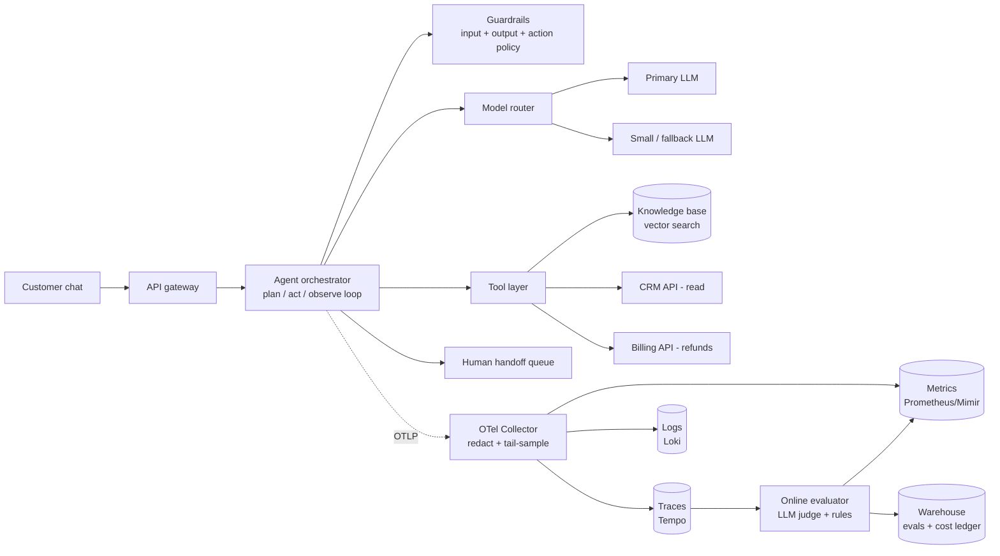

# Production Operations Architecture Review: "Resolve" Support Agent

An operations-focused review of how an agentic system is observed, measured, kept within budget, released, rolled back, and supported on call.

> **System under review (assumed).** *Resolve* is a customer-support agent. It runs a plan → act → observe loop. In that loop it calls an LLM through a model router, retrieves from a knowledge base, reads from a CRM, and can **take side-effecting actions** (issue refunds up to a capped amount). When it is not confident, it hands off to a human queue. All names, numbers and endpoints here are illustrative. Replace them with your own system's values.

## Architecture at a glance

## Repository map

| Deliverable | Location |
|---|---|
| One-page ADR: observability, SLIs/SLOs, cost controls, on-call | [`docs/adr/0001-production-operations.md`](docs/adr/0001-production-operations.md) |
| Tracing and metrics plan: signals, destinations, queries | [`docs/tracing-and-metrics-plan.md`](docs/tracing-and-metrics-plan.md) |
| Incident-response runbooks (4 scenarios) | [`runbooks/`](runbooks/) |
| Rollback and canary plan tied to eval and business metrics | [`docs/rollback-and-canary-plan.md`](docs/rollback-and-canary-plan.md) |
| Post-mortem template for agentic failures | [`templates/postmortem-agentic.md`](templates/postmortem-agentic.md) |
| Supporting config (SLOs, alerts, collector, canary gates) | [`config/`](config/) |

## Key positions taken in this review

1. **A trajectory is the unit of observation, not a request.** One user session fans out into many LLM calls, tool calls and retrievals. Every one of them is a span under a single session trace.
2. **Quality is an SLO, not a dashboard.** Task success, as scored by an online evaluator on sampled traffic, gets an error budget like availability does.
3. **Cost is bounded at three layers.** Per-step limits, per-session budgets and per-tenant/global budgets. Each layer has an automatic degrade path, not only an alert.
4. **Releases are bundles.** Model, prompt, tool schemas and router config are versioned together as one `agent_release`. Canaries promote or roll back the whole bundle against eval and business gates.
5. **Side effects get first-class treatment.** Refunds and other irreversible actions are traced, capped and reconciled. Every incident and post-mortem asks "what did the agent *do* in the world?"

## Not in scope

Model training, offline research evals, and application security review (beyond guardrail telemetry). This repo contains no credentials or customer data. Config files use `${env:...}` placeholders only.
