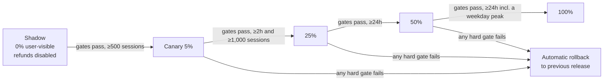

# Rollback and canary plan

## 1. What gets released

Every change ships as an immutable **`agent_release`** bundle. Each bundle has an id (e.g. `r2026.10.3`) and a manifest:

```yaml
release: r2026.10.3
model: { primary: provider-x/large-2026-09, fallback: provider-x/small-2026-08 }
prompts: { system: sha256:ab12…, planner: sha256:cd34… }
tools: { schema_version: 14, enabled: [kb_search, crm_lookup, issue_refund] }
router: { config: sha256:ef56… }
guardrails: { policy_version: 7 }
kb_index: kb-2026-10-18
```

Bundles are stored in the release registry. Traffic is split by a flag service using `session.id` hashing, so a session never changes release mid-conversation. Rollback is **one flag change** back to the previous bundle id. It has no build step and takes effect for new sessions within 60 s.

A model provider silently updating a model behind a fixed alias counts as a release. We pin dated model versions so that this cannot happen silently.

## 2. Pre-production gate (before any traffic)

| Check | Pass criteria |
|---|---|
| Offline eval suite (~1,200 labelled conversations + 150 adversarial) | Task success ≥ baseline − 1.0 pt. No regression > 3 pts in any intent category |
| Safety and policy suite | 0 policy-violating refunds. Jailbreak block rate ≥ baseline |
| Replay of 500 recent production sessions in a sandbox (tools mocked) | Cost/session ≤ baseline × 1.15. p95 steps ≤ baseline + 1 |
| Tool schema contract tests | 100% pass |

## 3. Canary stages



- **Shadow** runs the new bundle on mirrored traffic. Its responses are not shown, and its side-effecting tools are stubbed. This catches cost and loop blow-ups before any customer sees them.
- In **every stage**, canary and baseline are compared over the **same time window**. This avoids time-of-day bias.
- Refund actions at 5% are additionally capped at **$50 per refund** until the release reaches 50%.

## 4. Gates

Gates are evaluated every 15 minutes by the canary analysis job ([`config/canary-gates.yaml`](../config/canary-gates.yaml)).

| Gate | Signal | Hard fail (auto-rollback) | Soft fail (hold and page Agent Eng) |
|---|---|---|---|
| **Task success** | `agent_eval_score{dimension="task_success"}` | canary < baseline − 3 pts (significant at p<0.05) | canary < baseline − 1.5 pts |
| **Groundedness** | eval `dimension="grounded"` | < baseline − 3 pts | < baseline − 1.5 pts |
| **Action safety** | refunds failing policy audit | any (≥ 1) | n/a |
| **Escalation rate** (business) | `outcome="escalated"` share | > baseline × 1.25 | > baseline × 1.10 |
| **Resolution rate** (business) | `outcome="resolved"` share | < baseline − 4 pts | < baseline − 2 pts |
| **CSAT proxy** (business) | thumbs-down rate | > baseline × 1.3 | > baseline × 1.15 |
| **Cost per resolution** | cost ÷ resolved sessions | > baseline × 1.30 | > baseline × 1.15 |
| **Latency** | p95 TTFT, p95 session duration | > SLO, or > baseline × 1.25 | > baseline × 1.10 |
| **Errors** | session error rate, tool error rate | > baseline + 0.5 pt | > baseline + 0.2 pt |
| **Loops** | `agent_budget_exhausted_total` rate | > baseline × 2 | > baseline × 1.5 |

**Statistical guard.** We do not decide on fewer than 300 evaluated sessions per arm. Rates use a two-proportion z-test, and cost/latency use a Mann-Whitney test. Business metrics with lagging labels (CSAT, reopen-within-7-days) are checked again **7 days after 100%**. A regression found at that point triggers a rollback decision by the release owner, not an automatic rollback.

## 5. Rollback procedure

**Automatic rollback** (hard gate fails):
1. The flag service sets the canary weight to 0. New sessions go to the previous release.
2. Sessions already in progress on the bad release finish, unless *action safety* failed. In that case `agent.refunds_enabled=false` is set for that release immediately, and its in-flight sessions are handed off to humans.
3. The analysis job posts the failed gate, a query link and 5 example trace ids to `#resolve-releases`, and opens a Sev3 ticket (or Sev2 for a safety failure).

**Manual rollback** (on-call, during any incident):
```bash
# illustrative CLI; no credentials in repo
releasectl rollback resolve --to "$(releasectl previous resolve)" --reason "INC-1234"
releasectl status resolve    # confirm 100% on previous bundle
```

After any rollback:
- Check side effects. Run the refund reconciliation query in the warehouse for `release = <bad>`.
- Keep the bad bundle in the registry for analysis. Mark it `blocked`.
- Before the bundle can be re-promoted, the fix must add at least one regression case to the offline eval suite.

**Partial rollback is not allowed.** We do not roll back only the prompt while keeping the new model. Any mix of components is a new bundle and goes through the canary again.
