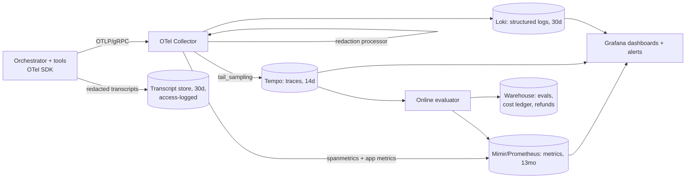

# Tracing and metrics plan

What Resolve emits, where each signal lands, and how on-call queries it.

## 1. Pipeline



Collector config: [`config/otel-collector.yaml`](../config/otel-collector.yaml).

## 2. Trace model

One trace per **session**. Span hierarchy:

```
agent.session                         (root; session.id, tenant.id_hash, agent.release, channel)
├── agent.step [n]                    (step.index, step.kind = plan|act|reflect|respond)
│   ├── gen_ai.chat <model>           (gen_ai.request.model, gen_ai.usage.input_tokens,
│   │                                  gen_ai.usage.output_tokens, cache_read_tokens,
│   │                                  cost.usd, router.reason, finish_reason, transcript.ref)
│   ├── guardrail.check               (guardrail.name, decision = allow|block|rewrite)
│   ├── tool.call <tool_name>         (tool.name, tool.args_hash, tool.status, tool.retry_count,
│   │                                  side_effect = none|reversible|irreversible)
│   │   └── http.client ...           (auto-instrumented)
│   └── retrieval.query               (kb.index_version, top_k, top_score, hit_count)
└── agent.outcome                     (outcome = resolved|escalated|abandoned|error|budget_exhausted,
                                       steps_total, cost_total_usd)
```

Rules:
- `agent.release` (the bundle id) is on **every** span and metric. Without it, canary analysis and rollback attribution are not possible.
- Refund spans add `refund.amount_bucket`, `refund.policy_rule`, and `refund.idempotency_key`. They **never** add account numbers or card data.
- Prompt and completion text are **not** span attributes. `transcript.ref` points to the redacted transcript store.
- Errors use span status plus `error.type` (`provider_timeout`, `rate_limited`, `schema_invalid`, `tool_5xx`, `guardrail_block`, `loop_detected`).

## 3. Metrics catalogue

| Metric | Type | Key labels | Source | Used for |
|---|---|---|---|---|
| `agent_sessions_total` | counter | `outcome`, `release`, `channel` | app | Availability SLI, success mix |
| `agent_session_duration_seconds` | histogram | `outcome`, `release` | app | Completion latency SLO |
| `agent_ttft_seconds` | histogram | `release`, `model` | app | Responsiveness SLO |
| `agent_steps_per_session` | histogram | `release` | app | Loop and drift signal |
| `gen_ai_client_token_usage` | histogram | `model`, `token_type`, `release` | app | Token and cost tracking |
| `gen_ai_client_operation_duration_seconds` | histogram | `model`, `provider`, `error_type` | app | Provider latency |
| `agent_cost_usd_total` | counter | `model`, `tenant_tier`, `release` | app | Cost-spike alerts, cost/resolution |
| `agent_tool_calls_total` | counter | `tool`, `status`, `release` | app | Tool reliability SLI |
| `agent_tool_duration_seconds` | histogram | `tool` | spanmetrics | Latency attribution |
| `agent_guardrail_decisions_total` | counter | `guardrail`, `decision` | app | Safety, drift |
| `agent_budget_exhausted_total` | counter | `limit` (`steps`/`tools`/`usd`/`loop`) | app | Runaway loops |
| `agent_refunds_total` / `agent_refund_usd_total` | counter | `policy_rule`, `release` | app | Side-effect monitoring |
| `agent_refund_audit_failures_total` | counter | `policy_rule`, `release` | audit job (every 5 min) | Action-safety SLO, Sev1 page |
| `agent_eval_score` | histogram | `evaluator`, `dimension`, `release` | evaluator | Task-success SLO, canary gates |
| `agent_eval_judge_agreement` | gauge | `evaluator` | weekly calibration job | Judge health |
| `retrieval_top_score` | histogram | `kb_index_version` | app | Retrieval and data drift |
| `agent_input_embedding_drift` | gauge | `window` | drift job (hourly) | Input-distribution drift |

Cardinality rules:
- Never use `session.id`, `user_id` or raw `tenant_id` as metric labels. Those belong in traces.
- `tenant_tier` has at most 4 values.
- `tool` and `model` come from enums in code.

## 4. How it's queried

Recording rules and alerts live in [`config/alerts.yaml`](../config/alerts.yaml). The queries on-call uses most:

```promql
# Availability SLI (28d)
1 - sum(rate(agent_sessions_total{outcome="error"}[28d])) / sum(rate(agent_sessions_total[28d]))

# p95 time to first token by release (compare canary vs baseline)
histogram_quantile(0.95, sum by (le, release) (rate(agent_ttft_seconds_bucket[10m])))

# Cost per resolved session, per release
sum by (release) (rate(agent_cost_usd_total[1h]))
  / sum by (release) (rate(agent_sessions_total{outcome="resolved"}[1h]))

# Task success (online eval) by release: share of judged sessions scoring >= 0.5 (pass)
sum by (release) (rate(agent_eval_score_bucket{dimension="task_success", le="0.5"}[1h]))
  / sum by (release) (rate(agent_eval_score_count{dimension="task_success"}[1h]))
# ^ this is the FAIL share; task success = 1 - it. Recording rule: agent:task_success:ratio_rate1h

# Where is latency coming from? Top tools by p95
topk(5, histogram_quantile(0.95, sum by (le, tool) (rate(agent_tool_duration_seconds_bucket[15m]))))
```

```traceql
# Sessions that hit a loop or budget limit in the last hour
{ name = "agent.outcome" && span.outcome = "budget_exhausted" }

# Slow sessions on the canary, with LLM calls > 8s
{ span.agent.release = "r2026.10.3" } >> { name =~ "gen_ai.chat.*" && duration > 8s }

# Every irreversible action in a session
{ span.side_effect = "irreversible" }
```

```logql
# Guardrail blocks with reason, for a specific release
{service="resolve-orchestrator"} | json | event="guardrail_decision" and decision="block" and release="r2026.10.3"
```

```sql
-- Warehouse: daily cost and success by release (for weekly review and post-mortems)
SELECT release, DATE(ended_at) AS day,
       COUNT(*) AS sessions,
       AVG(CASE WHEN outcome = 'resolved' THEN 1 ELSE 0 END) AS resolve_rate,
       SUM(cost_usd) / NULLIF(SUM(CASE WHEN outcome='resolved' THEN 1 ELSE 0 END),0) AS cost_per_resolution,
       AVG(eval_task_success) AS judged_success
FROM agent_sessions
WHERE ended_at >= CURRENT_DATE - 14
GROUP BY 1, 2 ORDER BY 2, 1;
```

## 5. Dashboards

1. **Agent overview:** SLO burn for all six SLIs, sessions by outcome, cost per hour against budget, and the current release split.
2. **Release compare:** canary and baseline side by side. Covers every canary gate metric (see the rollback plan).
3. **Trajectory health:** steps per session, tool error mix, loop and budget exhaustions, guardrail decisions.
4. **Cost:** spend by model, tenant tier and release. Cache hit ratio and tokens per step.
5. **Quality and drift:** eval scores by dimension, judge agreement, retrieval top-score distribution, input drift.
